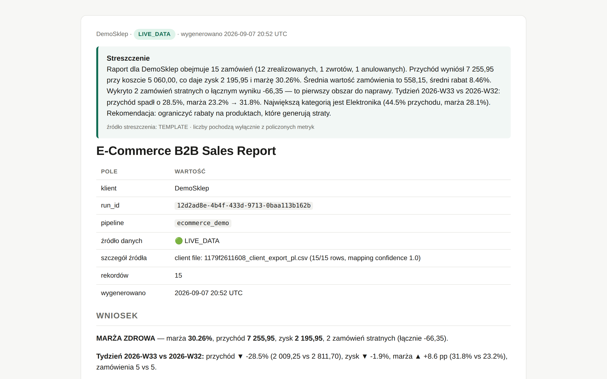
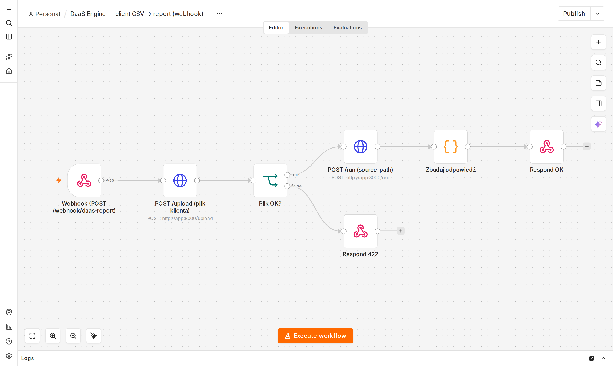

# DaaS Engine — automated weekly reports from any client dataset

Live: https://prochpc.pl

Source-agnostic **Data-as-a-Service** engine. A client sends a CSV or XLSX export; the engine detects the column mapping, loads it into DuckDB, computes KPIs and anomalies, and returns a ready-to-send HTML report with week-over-week deltas and a plain-language summary.

**Version 2.0** adds a hosted mode with a web cockpit next to the self-hosted one. **Stack:** Python 3.11+ (CI: 3.11, 3.12, 3.13) · FastAPI · DuckDB · Next.js · Docker

*[Polski README →](README.pl.md)*



---

## What you get

- **A weekly report from your own file.** Revenue, cost, profit, margin, average order value, loss-making orders, anomalies, week-over-week deltas and a "practical takeaways" section. Numbers come only from your file. Output: HTML (print to PDF), Markdown and JSON.
- **A cockpit** (cloud mode). Sign in with a link sent by e-mail (no passwords), drop a file, watch the progress, open the report, keep an archive. A "check yourself" box computes the SHA-256 of a downloaded report in your browser; the file is not uploaded.
- **An API** with a key per organization, scopes, live progress (Server-Sent Events) and signed webhooks. Examples: [`docs/API.md`](docs/API.md).
- **A collector of artifacts and a status report.** A read-only PowerShell collector (`tools/uksc-collector.ps1`) gathers technical settings of a Windows workstation into a hashed JSON package; the report lists control, requirement (UKSC/NIS2), status and artifact hash.
- **Your data stays yours.** Each organization has its own data directory and its own DuckDB file; uploads expire after a retention period you set; nothing is sent to an AI provider unless you opt in.

### Two modes, one code base

| | `selfhost` | `cloud` |
|---|---|---|
| For | you run everything on your own server or PC | PPC hosts it, or you host the multi-organization service |
| Organizations | one (`default`) | many, with members and roles |
| Sign-in | one instance key (`X-API-Key`) | e-mail link for people, API keys for machines |
| Run | `POST /run` (synchronous) or API v1 jobs | API v1 jobs (asynchronous, SSE progress) |
| Cockpit | optional | included (`web/`) |
| Start | `docker compose up` at the repository root, or `pip` | `deploy/compose.yml` on a VPS |

Design constraints that shaped it:

- **A missing API key is not an error.** Every external source degrades to a fixture instead of failing. The pipeline always produces a report; the reason for any degradation is returned in `source_detail`.
- **Source-agnostic ingestion.** Column names are detected, not configured: `Wartość brutto`, `gross_value` and `Revenue` all map to `revenue`.
- **The report is the product.** Output is a self-contained HTML file a client can open, not a dashboard they have to learn.

---

## Quickstart — Docker Compose (cloud, one VPS)

```bash
cd deploy
./gen-env.sh --domain reports.example.com     # creates .env with random secrets (never overwrites)
docker compose build
docker compose --profile edge up -d           # api + web + Caddy (TLS)
docker compose exec api python -m app.cli create-org --name "My Company" --owner-email owner@example.com
./smoke.sh --public https://reports.example.com --wait 90
```

Sign in at `https://reports.example.com/login` with the e-mail link (set `DAAS_EMAIL_BACKEND=smtp` in `.env`; with the default `console` the link appears in `docker compose logs api`). Install, update, rollback, backups and sharing the VPS with another application: [`deploy/README.md`](deploy/README.md).

Local trial without a domain or TLS: put these lines in `deploy/.env`, then `docker compose up -d --build` and open http://127.0.0.1:3000:

```
NEXT_PUBLIC_API_ORIGIN=http://127.0.0.1:8000
DAAS_COCKPIT_ORIGIN=http://127.0.0.1:3000
DAAS_COOKIE_SECURE=false
```

## Quickstart — Docker Compose (selfhost, with n8n)

```bash
cp .env.example .env          # set DAAS_API_KEY (min. 16 characters; openssl rand -hex 24) before the first start
docker compose up --build
```

| Service | URL |
|---|---|
| API | `http://127.0.0.1:8000` (interactive docs at `/docs` only with `APP_ENV=dev`) |
| n8n | `http://127.0.0.1:5678` |

The DuckDB database and generated reports land in `./runtime/` (host volume). Import a workflow in n8n via **Workflows → Import from file**: `n8n/daas_workflow.json` (scheduled run) or `n8n/daas_client_report.json` (client file → report).

## Quickstart — pip (no Docker)

```bash
python -m venv .venv && . .venv/bin/activate          # Windows: py -3.11 -m venv .venv; .\.venv\Scripts\Activate.ps1
pip install --require-hashes -r requirements-dev.lock && pip install --no-deps -e .
export DAAS_API_KEY="$(openssl rand -hex 24)"
python -m app.main                                     # http://127.0.0.1:8000
```

Windows without Docker or a shell setup: `URUCHOM_DAAS_PYTHON.ps1` (Python check, venv, tests, server, sample upload and report in the browser). If `Activate.ps1` is blocked: `Set-ExecutionPolicy -Scope CurrentUser RemoteSigned`.

Cloud mode from source: `DAAS_MODE=cloud DAAS_SECRET_KEY=$(openssl rand -hex 32) python -m app.main`, then the cockpit with `cd web && npm ci && npm run build` and `npm run dev` (details: [`web/README.md`](web/README.md)).

---

## The "client file → report" flow

Cloud / API v1 (full reference: [`docs/API.md`](docs/API.md)):

```bash
export DAAS=http://127.0.0.1:8000 KEY="daas_..." ORG="01J..."      # key and organization id from the cockpit or create-org

# 1. Upload — returns the detected column mapping
curl -H "X-API-Key: $KEY" -F "file=@data/fixtures/client_export_pl.csv" "$DAAS/api/v1/orgs/$ORG/uploads"

# 2. Start a job with the upload id — 202 Accepted
curl -X POST -H "X-API-Key: $KEY" -H "Content-Type: application/json" \
     -d '{"pipeline":"ecommerce_demo","upload_id":"<id from step 1>"}' "$DAAS/api/v1/orgs/$ORG/jobs"

# 3. When the job has succeeded, fetch the report (fmt: html | md | json)
curl -H "X-API-Key: $KEY" "$DAAS/api/v1/orgs/$ORG/runs/<run_id>/report?fmt=html" -o report.html
```

Selfhost legacy routes (same engine, one organization): `POST /upload` → `POST /run` → `GET /reports/{pipeline}/latest`, each with `X-API-Key: $DAAS_API_KEY`.



---

## Architecture

```
app/
├── api/          FastAPI routes: legacy (selfhost) and /api/v1 (organizations, keys, uploads, jobs, runs, webhooks)
├── control/      control plane: accounts, keys, jobs, audit, usage (SQLAlchemy + Alembic), tenants, job executor
├── core/         config, auth, rate limits, upload guard, XLSX import, redaction, observability
├── sources/      ingestion: FACEIT, Apify, CSV/XLSX column mapper, collector package
├── transforms/   metric computation per domain
├── storage/      DuckDB client
├── pipelines/    orchestration (runner)
└── reporting/    HTML / Markdown / JSON generators + narrative
web/              cockpit (Next.js 16, React 19, TypeScript, Tailwind 4)
deploy/           compose, Caddyfile, env generator, backup, restore, smoke test
docs/             API, architecture, deployment, security, DPA, pilot materials
```

Three reference pipelines ship with the engine:

| Pipeline | Domain | Source |
|---|---|---|
| `ecommerce_demo` | orders, revenue, margin | Apify, CSV/XLSX upload, local CSV/XLSX file, or fixture |
| `cs2_demo` | esports statistics (match performance) | FACEIT API or fixture |
| `uksc_evidence` | collector of artifacts + status report: Windows workstation controls mapped to UKSC/NIS2 | JSON package from `tools/uksc-collector.ps1`, or fixture |

More: [`docs/ARCHITECTURE.md`](docs/ARCHITECTURE.md) (control plane, data plane, modes, executor).

---

## Metrics

**`ecommerce_demo`**
`revenue_total`, `cost_total`, `profit_total`, `margin_pct`, `avg_order_value`, `avg_discount_pct`, `loss_orders` (orders with negative profit), `top_categories`, `top_products`, ISO-week aggregation and week-over-week deltas (revenue %, profit %, margin in percentage points).

Anomaly detectors: `NEGATIVE_PROFIT`, `DEEP_DISCOUNT`, `MARGIN_OUTLIER`, `REVENUE_OUTLIER`.

**`cs2_demo`**
`win_rate`, `kd_ratio`, `avg_rating`, `avg_adr`, `hs_pct`, `form_score` (0–100, weighted over the last 5 matches), `form_trend` (UP/FLAT/DOWN), and a per-map breakdown with best and worst map.

---

## Configuration and fallback behaviour

Every variable is optional except the secrets of the mode you run (`DAAS_API_KEY` in selfhost, `DAAS_SECRET_KEY` in cloud). Without source keys the engine runs on fixtures and still produces a full report. The full list with defaults is in [`docs/DEPLOY.md`](docs/DEPLOY.md) and [`.env.example`](.env.example).

| Variable | Used by | Fallback when absent or failing |
|---|---|---|
| `FACEIT_API_KEY`, `FACEIT_PLAYER_NICKNAME` | `cs2_demo` | fixture `cs2_matches.json` → `MOCK_DATA` |
| `APIFY_TOKEN`, `APIFY_DATASET_ID` | `ecommerce_demo` | `ECOMMERCE_CSV_PATH`, then fixture `ecommerce_orders.csv` → `MOCK_DATA` |
| `ECOMMERCE_CSV_PATH` | `ecommerce_demo` | fixture |
| `DAAS_LLM_NARRATIVE` + `ANTHROPIC_API_KEY` | report summary (opt-in) | deterministic template (`narrative_source: TEMPLATE`) |
| `DISCORD_WEBHOOK_URL` | `/run?notify=true` (selfhost) | notification skipped, run still succeeds |
| `DAAS_PUBLIC_URL` (n8n environment) | report links in `n8n/daas_client_report.json` behind a reverse proxy | `http://localhost:8000` |

Network failures (timeouts, `401`, upstream schema changes) trigger the same fallback path. The pipeline does not crash; the cause is always reported in `source_detail`.

---

## Documentation

| Document | Contents |
|---|---|
| [`docs/API.md`](docs/API.md) | routes, scopes, errors, `curl` examples, SSE, webhook signature |
| [`docs/ARCHITECTURE.md`](docs/ARCHITECTURE.md) | control plane, data plane, modes, job executor |
| [`docs/DEPLOY.md`](docs/DEPLOY.md), [`deploy/README.md`](deploy/README.md) | install on a VPS, update, rollback, backups, all environment variables |
| [`docs/SECURITY.md`](docs/SECURITY.md) | threat model, controls, known limitations, how to report |
| [`docs/DPA_v1_PL.md`](docs/DPA_v1_PL.md) | data processing agreement, version 1 (draft awaiting legal review) |
| [`docs/pilot/`](docs/pilot) | pilot offer, input requirements, onboarding, demo script (Polish) |
| [`CHANGELOG.md`](CHANGELOG.md), [`VALIDATION.md`](VALIDATION.md) | history, manual validation checklist |

---

## Tests

```bash
pytest                                  # backend, offline
cd web && npm test && npm run e2e       # cockpit: unit tests; e2e needs the API in cloud mode (see web/README.md)
```

CI runs on every push (`.github/workflows/ci.yml`): backend tests on Python 3.11, 3.12 and 3.13, security scans (gitleaks, semgrep, zizmor, pip-audit), cockpit lint/typecheck/tests/build, Playwright end-to-end tests and Docker image builds with a container smoke test.

---

Contact: prochpc@gmail.com · https://prochpc.pl
