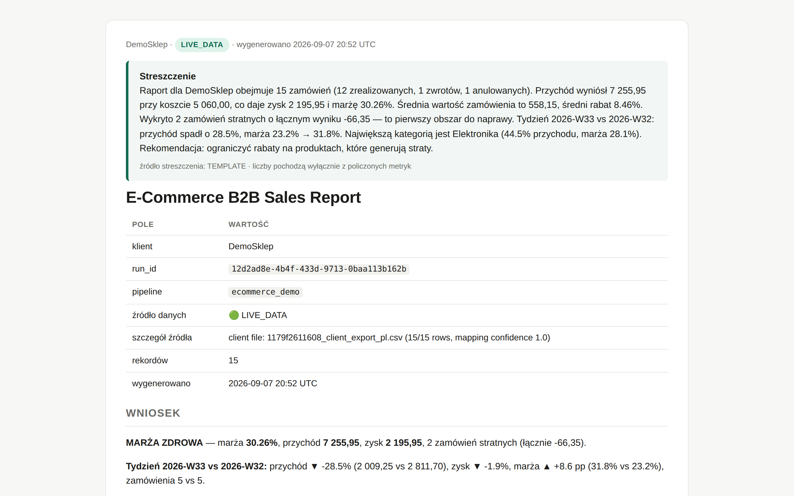
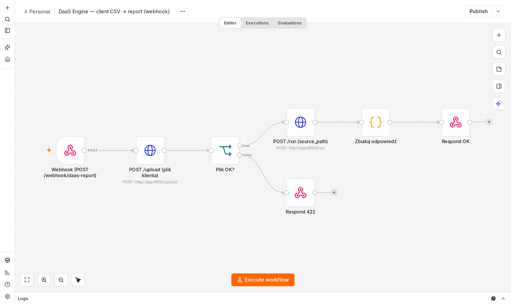

# DaaS Engine — automated weekly reports from a sales export

[](https://github.com/emsior/daas-engine/actions/workflows/ci.yml)
[](https://github.com/emsior/daas-engine/actions/workflows/opsec.yml)
[](LICENSE)

Weekly KPI reports from CSV/XLSX sales exports. FastAPI + DuckDB engine, Next.js cockpit, REST API and built-in MCP server (OAuth 2.1) for AI assistants.

A client sends a CSV or XLSX export; the engine maps the columns of a sales export, loads it into DuckDB, computes KPIs and anomalies, and returns a ready-to-send HTML report with week-over-week deltas and a plain-language summary.

**Status:** v2.0 on main, release pending (the only tag is v1.0.0). Hosted mode (v2.0 on main): web cockpit, REST API, e-mail magic-link sign-in, organization roles, weekly export reminders with auto-run on upload, built-in MCP server with OAuth 2.1. The cockpit, sign-in, roles, reminders and OAuth need `DAAS_MODE=cloud`; the default mode is `selfhost`. **Stack:** Python 3.11+ (CI: 3.11, 3.12, 3.13) · FastAPI · DuckDB · Next.js · Docker

Built and maintained by Proch PC with AI coding agents · [MIT](LICENSE)

▶ [Demo video](docs/daas_demo.mp4) (v0.3 flow, 50 s, no sound).

*[Polski README →](README.pl.md)*



---

## What you get

- **A weekly report from your own file.** Revenue, cost, profit, margin, average order value, loss-making orders, anomalies, week-over-week deltas and a "practical takeaways" section. Numbers come only from your file. Output: HTML (print to PDF), Markdown and JSON. Report language: for an organization with locale `en` only the report title is in English and data tables show raw field names (`week_start`, `margin_pct`) as column headers; the section headings, the verdict, the summary-metrics table, the "practical takeaways", the template summary and the HTML header and footer stay in Polish. The `uksc_evidence` report is Polish only.
- **A cockpit** (cloud mode). Sign in with a link sent by e-mail (no passwords), drop a file, watch the progress, open the report, keep an archive. A "check yourself" box computes the SHA-256 of a downloaded report in your browser; the file is not uploaded.
- **An API** with a key per organization, scopes, live progress (Server-Sent Events) and signed webhooks. Examples: [`docs/API.md`](docs/API.md).
- **Agent access (MCP).** MCP clients such as Claude and ChatGPT can connect via OAuth 2.1 (cloud mode) or with an API key and query the reports. See [Agent access (MCP)](#agent-access-mcp).
- **A collector of artifacts and a status report.** A read-only PowerShell collector (`tools/uksc-collector.ps1`) gathers technical settings of a Windows workstation into a hashed JSON package; the report lists control, requirement (UKSC/NIS2), status and artifact hash.
- **Your data stays yours.** Each organization has its own data directory and its own DuckDB file; uploads expire after a retention period you set; nothing is sent to an AI provider unless you opt in.

### Two modes, one code base

| | `selfhost` | `cloud` |
|---|---|---|
| For | you run everything on your own server or PC | PPC hosts it, or you host the multi-organization service |
| Organizations | one (`default`) | many, with members and roles |
| Sign-in | one instance key (`X-API-Key`) | e-mail link for people, API keys for machines |
| Run | `POST /run` (synchronous) or API v1 jobs | API v1 jobs (asynchronous, SSE progress) |
| Cockpit | none (the cockpit needs `cloud`) | included (`web/`) |
| Start | `docker compose up` at the repository root, or `pip` | `deploy/compose.yml` on a VPS |

Design constraints that shaped it:

- **A missing API key is not an error.** Every external source degrades to a fixture instead of failing. The pipeline always produces a report; the reason for any degradation is returned in `source_detail`.
- **Column mapping for sales exports.** The mapper maps the columns of a sales export to one order schema using Polish and English header aliases, so headers are detected, not configured: `Wartość brutto`, `Kwota` and `Revenue` all map to `revenue`.
- **The report is the product.** Output is a self-contained HTML file a client can open, not a dashboard they have to learn.

---

## Quickstart — Docker Compose (cloud, one VPS)

```bash
cd deploy
./gen-env.sh --domain reports.example.com     # creates .env with random secrets (never overwrites)
docker compose build
docker compose --profile edge up -d           # api + web + Caddy (TLS)
docker compose exec api python -m app.cli create-org --name "My Company" --owner-email owner@example.com
./smoke.sh --public https://reports.example.com --wait 90
```

Sign in at `https://reports.example.com/login` with the e-mail link (set `DAAS_EMAIL_BACKEND=smtp` in `.env`; with the generated `console` backend the link is written only to a file in `runtime/outbox/` inside the `runtime` volume, not to the log). Install, update, rollback, backups and sharing the VPS with another application: [`deploy/README.md`](deploy/README.md).

### Try cloud mode locally

Without `--domain`, `gen-env.sh` writes `deploy/.env` for `localhost` (console mail, same origin through Caddy). Ports 80 and 443 must be free.

```bash
cd deploy && ./gen-env.sh && docker compose --profile edge up -d --build
docker compose exec api python -m app.cli create-org --name "Demo" --owner-email owner@example.com
```

Open https://localhost/login (the certificate comes from Caddy's local CA, so the browser shows a warning) and request a link for the owner e-mail. The link is in a JSON file in the outbox: `docker compose exec api sh -c 'cat /data/runtime/outbox/*.json'` (field `link`). `create-org` also prints a one-time API key for the API and MCP.

Without Caddy and TLS: after `./gen-env.sh`, set these lines in `deploy/.env` (change the two that exist, add the third), run `docker compose up -d --build` (no `edge` profile) and open http://127.0.0.1:3000:

```
NEXT_PUBLIC_API_ORIGIN=http://127.0.0.1:8000
DAAS_COCKPIT_ORIGIN=http://127.0.0.1:3000
DAAS_COOKIE_SECURE=false
```

## Quickstart — Docker Compose (selfhost, with n8n)

```bash
cp .env.example .env          # set DAAS_API_KEY (min. 16 characters; openssl rand -hex 24) before the first start
docker compose up --build
```

| Service | URL |
|---|---|
| API | `http://127.0.0.1:8000` (interactive docs at `/docs` only with `APP_ENV=dev`) |
| n8n | `http://127.0.0.1:5678` |

The DuckDB database and generated reports land in `./runtime/` (host volume). Import a workflow in n8n via **Workflows → Import from file**:

- `n8n/daas_workflow.json` — scheduled run (Monday 07:00) of both pipelines, formatting and an alert branch. The alert fires on a failed run, missing data, or a **week-over-week revenue drop of 15% or more, or a margin drop of 3 percentage points or more**.
- `n8n/daas_client_report.json` — client file → report over a webhook (upload → run → link to the HTML report).
- `n8n/pilot_workflow.json` — scheduled run with a `/health` gate, a Notion log entry and a Slack alert on failure; set the environment variables `NOTION_DAAS_DB_ID`, `SLACK_ALERT_CHANNEL` and `DAAS_APP_URL` for it.

## Quickstart — pip (no Docker)

```bash
python -m venv .venv && . .venv/bin/activate          # Windows: py -3.11 -m venv .venv; .\.venv\Scripts\Activate.ps1
pip install --require-hashes -r requirements-dev.lock && pip install --no-deps -e .
export DAAS_API_KEY="$(openssl rand -hex 24)"
export APP_HOST=127.0.0.1 APP_PORT=8000                # change the listen address/port here (see .env.example)
python -m app.main                                     # http://$APP_HOST:$APP_PORT
```

`python -m app.main` binds to `APP_HOST:APP_PORT` (defaults `127.0.0.1:8000`); set those variables to change it. In `selfhost` a non-loopback `APP_HOST` requires `DAAS_API_KEY`. For a production self-host that does not run the test suite, install `requirements.lock` instead of `requirements-dev.lock` — it holds the runtime dependencies only, while `-dev` adds pytest, ruff and the other developer tools (needed for the Tests section below). The lockfiles install on Windows as well (the Linux-only `uvloop` is skipped by a platform marker). Windows without Docker or a shell setup: `URUCHOM_DAAS_PYTHON.ps1` (Python check, venv, tests, server, sample upload and report in the browser). If `Activate.ps1` is blocked: `Set-ExecutionPolicy -Scope CurrentUser RemoteSigned`.

Cloud mode from source: `DAAS_MODE=cloud DAAS_SECRET_KEY=$(openssl rand -hex 32) python -m app.main`, then the cockpit with `cd web && npm ci && npm run build` and `npm run dev` (details: [`web/README.md`](web/README.md)).

---

## The "client file → report" flow

Cloud / API v1 (full reference: [`docs/API.md`](docs/API.md)):

```bash
export DAAS=http://127.0.0.1:8000 KEY="daas_..." ORG="01J..."      # key and organization id from the cockpit or create-org

# 1. Upload — returns the detected column mapping
curl -H "X-API-Key: $KEY" -F "file=@data/fixtures/client_export_pl.csv" "$DAAS/api/v1/orgs/$ORG/uploads"

# 2. Start a job with the upload id — 202 Accepted
curl -X POST -H "X-API-Key: $KEY" -H "Content-Type: application/json" \
     -d '{"pipeline":"ecommerce_demo","upload_id":"<id from step 1>"}' "$DAAS/api/v1/orgs/$ORG/jobs"

# 3. When the job has succeeded, fetch the report (fmt: html | md | json)
curl -H "X-API-Key: $KEY" "$DAAS/api/v1/orgs/$ORG/runs/<run_id>/report?fmt=html" -o report.html
```

A machine key for this flow needs the scopes `uploads:write runs:write runs:read reports:read` — `runs:read` is required even to only upload and run, because without it the caller cannot poll the job or list the run to get the `run_id`, so the report cannot be fetched. Full scope table: [`docs/API.md`](docs/API.md#scopes-and-roles).

### Every week without clicks

In the cockpit, *Settings → Schedule and notifications* (or `PUT /api/v1/orgs/{org_id}/schedule`): a weekly e-mail reminder to export (for example Monday 8:00 Europe/Warsaw, skipped when the file already came in), an automatic run right after the upload and an e-mail with a link to the report when it is ready. A short message can also go to the team chat (Slack, Microsoft Teams or any JSON webhook) with the status, data period, report hash and the link. The messages carry no report content; the data stays in the cockpit. Details: [`docs/API.md`](docs/API.md#schedule-and-notifications).

The *Data health* screen (or `GET /api/v1/orgs/{org_id}/data-health`) tells whether next Monday's report is safe: files, reports and failures week by week, the streak of weeks with a report and what to fix, each item linked to the right screen ([`docs/API.md`](docs/API.md#data-health)).

Selfhost legacy routes (same engine, one organization `default`), each with `X-API-Key: $DAAS_API_KEY`:

```bash
# 1. Upload a CSV or XLSX (returns the detected mapping and a ready-to-send run_payload)
curl -s -H "X-API-Key: $DAAS_API_KEY" -F "file=@data/fixtures/client_export_pl.csv" -F "client_name=Demo Shop" localhost:8000/upload
# {"rows":15,"confidence":1.0,"ready":true,"mapping":{"revenue":"Wartość brutto",...},
#  "run_payload":{"pipeline":"ecommerce_demo","upload_id":"<32 hex>","client_name":"Demo Shop"}}

# 2. Run (synchronous; the answer carries run_status, data_status and the report paths)
curl -s -X POST localhost:8000/run -H "X-API-Key: $DAAS_API_KEY" -H "Content-Type: application/json" \
  -d '{"pipeline":"ecommerce_demo","upload_id":"<upload_id>","client_name":"Demo Shop"}'

# 3. Fetch the report — latest for a pipeline, or a specific run by id (fmt: html | md | json)
curl -s -H "X-API-Key: $DAAS_API_KEY" "localhost:8000/reports/ecommerce_demo/latest?fmt=html" -o report.html
curl -s -H "X-API-Key: $DAAS_API_KEY" "localhost:8000/reports/run/<run_id>?fmt=html" -o report.html
```

`run_status` is `SUCCESS` / `PARTIAL` (0 records) / `FAILED` (still HTTP 200, detail in `error`); `data_status` is `LIVE_DATA` / `MOCK_DATA` / `BLOCKED_MISSING_SECRET`. A pipeline without a file (fixture fallback) runs with just `{"pipeline":"cs2_demo"}`. The column mapper detects separators, encodings (utf-8/cp1250), Polish and English headers and amounts such as `1 299,00 zł`; XLSX goes through the same path after conversion (limits: [`docs/pilot/INPUT_REQUIREMENTS_PL.md`](docs/pilot/INPUT_REQUIREMENTS_PL.md)).



---

## Agent access (MCP)

MCP clients (for example Claude, ChatGPT, Codex or Gemini) can use DaaS Engine as a tool: the API has a built-in MCP server at `POST /mcp` (Streamable HTTP, stateless, JSON). Connect it with an organization API key in `Authorization: Bearer <key>` and ask for the flow in plain language; 13 tools cover upload (CSV text or an XLSX file), runs (optionally for a chosen period), reports, hash verification, artifact status and usage, always inside the key's organization; reports are also available as MCP resources, and in cloud mode MCP clients such as Claude and ChatGPT can connect via OAuth 2.1 instead of a key.

```bash
claude mcp add --transport http daas https://reports.example.com/mcp --header "Authorization: Bearer $KEY"
```

Report text comes from customer files: for the agent it is data, not instructions. Setup for other clients, limits and security: [`docs/MCP.md`](docs/MCP.md).

---

## Architecture

```
app/
├── api/          FastAPI routes: legacy (selfhost) and /api/v1 (organizations, keys, uploads, jobs, runs, webhooks)
├── control/      control plane: accounts, keys, jobs, audit, usage (SQLAlchemy + Alembic), tenants, job executor
├── core/         config, auth, rate limits, upload guard, XLSX import, redaction, observability
├── sources/      ingestion: FACEIT, Apify, CSV/XLSX column mapper, collector package
├── transforms/   metric computation per domain
├── storage/      DuckDB client
├── pipelines/    orchestration (runner)
└── reporting/    HTML / Markdown / JSON generators + narrative
web/              cockpit (Next.js 16, React 19, TypeScript, Tailwind 4)
deploy/           compose, Caddyfile, env generator, backup, restore, smoke test
docs/             API, architecture, deployment, security, DPA, pilot materials
```

Three reference pipelines ship with the engine:

| Pipeline | Domain | Source |
|---|---|---|
| `ecommerce_demo` | orders, revenue, margin | Apify, CSV/XLSX upload, local CSV/XLSX file, or fixture |
| `cs2_demo` | esports statistics (match performance) | FACEIT API or fixture |
| `uksc_evidence` | collector of artifacts + status report: Windows workstation controls mapped to UKSC/NIS2 | JSON package from `tools/uksc-collector.ps1`, or fixture |

More: [`docs/ARCHITECTURE.md`](docs/ARCHITECTURE.md) (control plane, data plane, modes, executor).

---

## Metrics

**`ecommerce_demo`**
`revenue_total`, `cost_total`, `profit_total`, `margin_pct`, `avg_order_value`, `avg_discount_pct`, `loss_orders` (orders with negative profit), `top_categories`, `top_products`, ISO-week aggregation and week-over-week deltas (revenue %, profit %, margin in percentage points).

Anomaly detectors: `NEGATIVE_PROFIT`, `DEEP_DISCOUNT`, `MARGIN_OUTLIER`, `REVENUE_OUTLIER`.

**`cs2_demo`**
`win_rate`, `kd_ratio`, `avg_rating`, `avg_adr`, `hs_pct`, `form_score` (0–100, weighted over the last 5 matches), `form_trend` (UP/FLAT/DOWN), and a per-map breakdown with best and worst map.

---

## Configuration and fallback behaviour

Every variable is optional except the secrets of the mode you run (`DAAS_API_KEY` in selfhost, `DAAS_SECRET_KEY` in cloud). Without source keys the engine runs on fixtures and still produces a full report. The full list with defaults is in [`docs/DEPLOY.md`](docs/DEPLOY.md) and [`.env.example`](.env.example).

| Variable | Used by | Fallback when absent or failing |
|---|---|---|
| `FACEIT_API_KEY`, `FACEIT_PLAYER_NICKNAME` | `cs2_demo` | fixture `cs2_matches.json` → `MOCK_DATA` |
| `APIFY_TOKEN`, `APIFY_DATASET_ID` | `ecommerce_demo` | `ECOMMERCE_CSV_PATH`, then fixture `ecommerce_orders.csv` → `MOCK_DATA` |
| `ECOMMERCE_CSV_PATH` | `ecommerce_demo` | fixture |
| `DAAS_LLM_NARRATIVE` + `ANTHROPIC_API_KEY` | report summary (opt-in) | deterministic template (`narrative_source: TEMPLATE`) |
| `DISCORD_WEBHOOK_URL` | `/run?notify=true` (selfhost) | notification skipped, run still succeeds |
| `DAAS_PUBLIC_URL` (n8n environment) | report links in `n8n/daas_client_report.json` behind a reverse proxy | `http://localhost:8000` |

Network failures (timeouts, `401`, upstream schema changes) trigger the same fallback path. The pipeline does not crash; the cause is always reported in `source_detail`.

---

## Documentation

| Document | Contents |
|---|---|
| [`docs/API.md`](docs/API.md) | routes, scopes, errors, `curl` examples, SSE, webhook signature |
| [`docs/MCP.md`](docs/MCP.md) | MCP server for AI agents: tools, client setup, limits, prompt-injection note |
| [`docs/ARCHITECTURE.md`](docs/ARCHITECTURE.md) | control plane, data plane, modes, job executor |
| [`docs/DEPLOY.md`](docs/DEPLOY.md), [`deploy/README.md`](deploy/README.md) | install on a VPS, update, rollback, backups, all environment variables |
| [`docs/SECURITY.md`](docs/SECURITY.md) | threat model, controls, known limitations, how to report |
| [`docs/DPA_v1_PL.md`](docs/DPA_v1_PL.md) | data processing agreement, version 1 (draft awaiting legal review) |
| [`docs/pilot/`](docs/pilot) | pilot offer, input requirements, onboarding, demo script (Polish) |
| [`CHANGELOG.md`](CHANGELOG.md) | history of changes |
| [`docs/PROCESS.md`](docs/PROCESS.md) | how the project is built with AI coding agents |
| [`docs/history/VALIDATION.md`](docs/history/VALIDATION.md) | historical manual validation checklist from v0.x (September 2026, Polish) |

---

## Tests

```bash
pytest                                  # backend, offline
cd web && npm test && npm run e2e       # cockpit: unit tests; e2e needs the API in cloud mode (see web/README.md)
```

CI runs on every pull request and every push to main ([Actions](https://github.com/emsior/daas-engine/actions)): 2,600+ Python tests on Python 3.11–3.13, PostgreSQL, Playwright in three engines (Chromium, Firefox, WebKit), Docker build and security scans. In detail (`.github/workflows/ci.yml`): backend tests on Python 3.11, 3.12 and 3.13, control-plane tests on a real PostgreSQL (row locks, migrations), security scans (gitleaks, semgrep, zizmor, pip-audit), cockpit lint/typecheck/tests/build, Playwright end-to-end tests in Chromium, Firefox and WebKit, a Lighthouse gate and Docker image builds with a container smoke test. Optional pre-commit hooks (gitleaks, `.pre-commit-config.yaml`) and CI checks (gitleaks in the `security` job, the `OPSEC` workflow) block leaks of secrets and personal data.

---

Contact: prochpc@gmail.com · https://prochpc.pl
